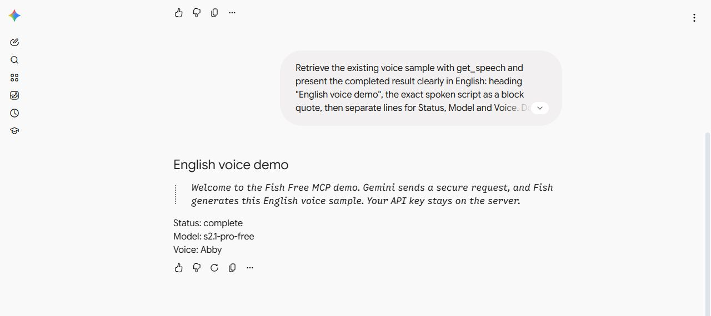
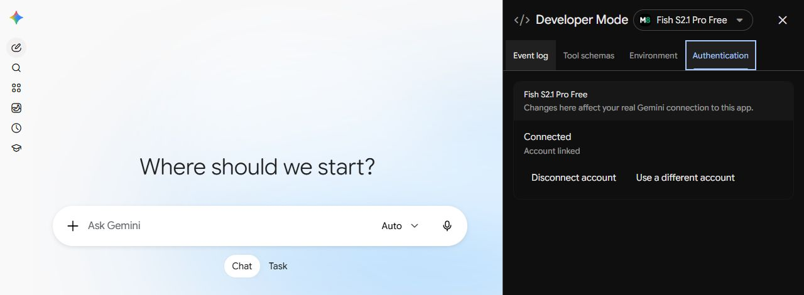
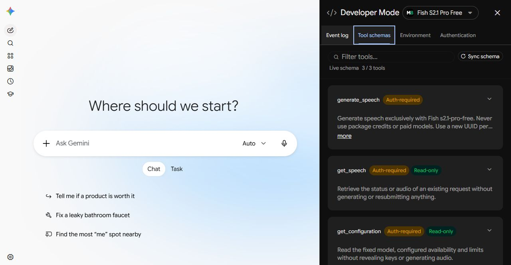
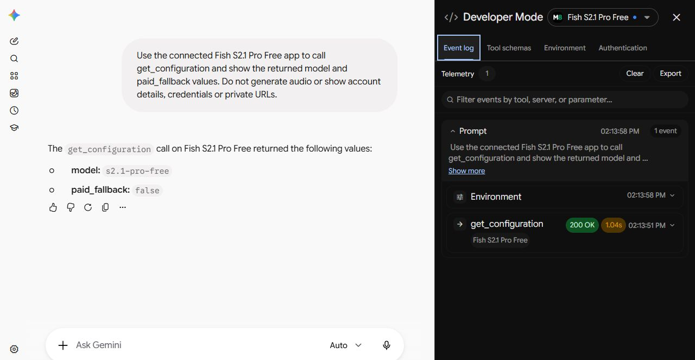
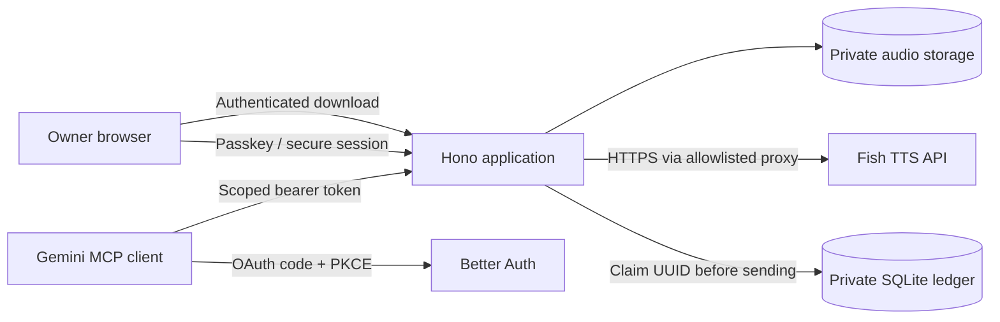
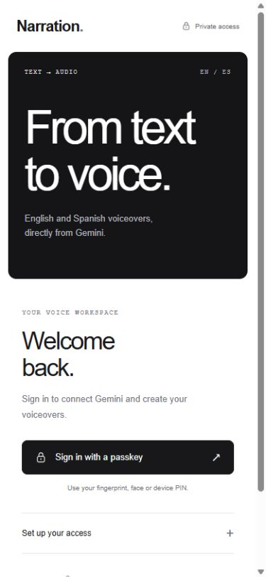
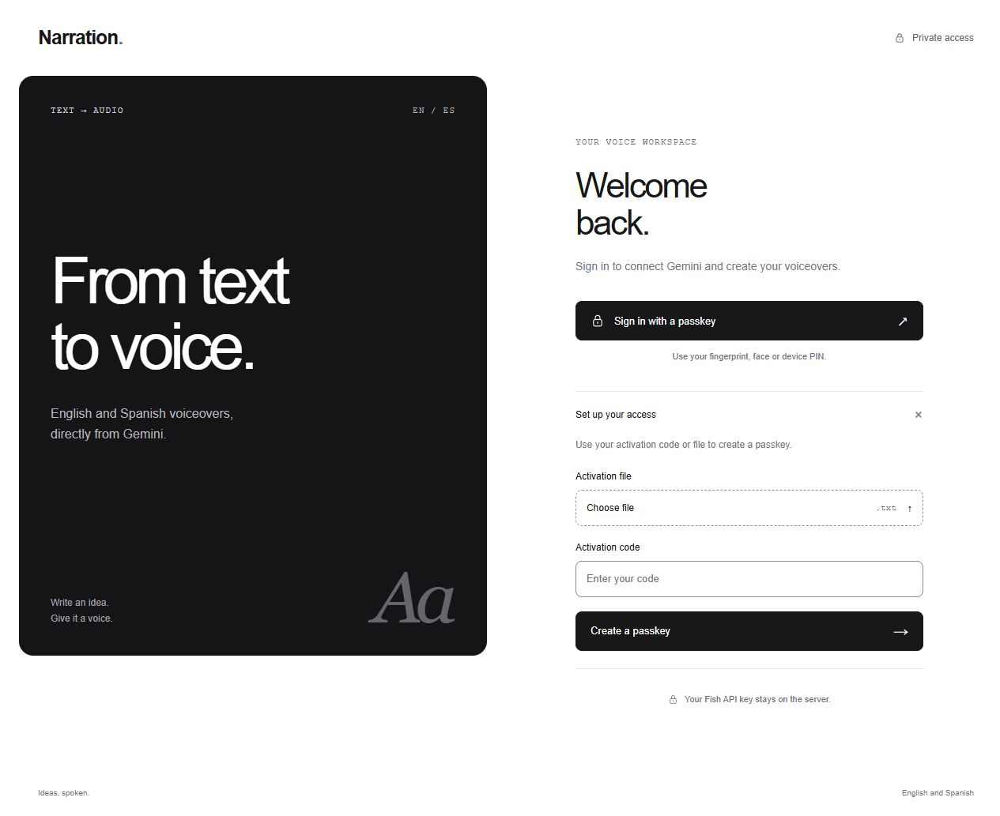

# Fish Free MCP

A single-owner MCP gateway that lets Gemini generate speech with **Fish S2.1 Pro Free** while keeping the provider API key on the server.

This repository is a runnable, sanitized technical-review snapshot by **Kenneth Yepez**. It includes the application, security tests, a constrained container template, real Gemini integration screenshots and an original English voice sample. It contains no deployment credentials, personal recordings or private operational history.



**[Download the original English MP3 — 10.92 seconds](docs/audio/fish-free-mcp-demo-en.mp3?raw=1)** · [Transcript](docs/audio/transcript.txt) · [Sample integrity and details](docs/audio/demo.json)

## The problem and the result

A connected voice integration can expose only its paid models, even when the provider offers a separate free API model. Passing an API key into each conversation also gives the chat access to a credential it does not need.

This gateway exposes three narrow MCP tools and keeps synthesis behind an authenticated service. Gemini receives a scoped OAuth connection, not the Fish API key. The application fixes the provider, endpoint, model and playback speed; it cannot silently switch to a paid model.

The connected demonstration exercises Gemini configuration lookup, English synthesis, retrieval of the same request and delivery of the original MP3. The screenshots and public audio below document that flow without publishing the account or private service address. See [verification scope](docs/VERIFICATION.md) for the checks and their limits.

## Gemini integration demo

### 1. A real linked account

Gemini Developer Mode shows the private MCP app as **Connected / Account linked**. No provider API key is entered into the conversation.



### 2. Three authenticated tools

The live schema exposes `get_configuration`, `generate_speech` and `get_speech`. Read-only retrieval is separate from synthesis.



### 3. A real tool call

The configuration lookup returns the fixed model and paid-fallback policy; Gemini's event log records the tool call.



### 4. The original English audio

> Welcome to the Fish Free MCP demo. Gemini sends a secure request, and Fish generates this English voice sample. Your API key stays on the server.

- **Model:** `s2.1-pro-free`
- **Voice:** Abby, a public US English catalog voice; no personal voice was cloned.
- **Original file:** MP3, mono, 44.1 kHz, 10.919125 seconds.
- **Processing:** no editing, trimming, conversion or speed changes.

**[Download the English voice sample](docs/audio/fish-free-mcp-demo-en.mp3?raw=1)**. The sample was generated through Gemini and the authenticated gateway. The original file's checksum matches the service receipt retained privately. [Read the demonstration notes](docs/GEMINI-DEMO.md).

Normal service downloads remain owner-authenticated. This one generic demonstration file was explicitly approved for publication; it does not make the private audio store public.

## Start the local review

Use Node.js **24 LTS** and npm.

```sh
npm ci --ignore-scripts
npm run build
npm test
npm run preview:local
```

Open **http://localhost:38875**. This is an isolated UI fixture: it binds to loopback, creates temporary local state, does not connect to Fish, and has no real API key or activation credential. The sign-in and setup interface is real; the fixture is not a working voice-generation demo. Stop it with Ctrl+C.

```sh
npm run typecheck
npm run check:publication
npm audit
```

The CI workflow repeats build, tests and publication checks on Node 24 and scans Git history for secrets. It does not receive production secrets or deploy anything.

## Architecture



| Area | Implementation |
| --- | --- |
| HTTP and validation | TypeScript, Hono and strict Zod schemas |
| Human authentication | Maintained Better Auth / WebAuthn passkey libraries |
| Machine authorization | OAuth authorization code, PKCE S256, audience and scope checks |
| Job integrity | SQLite ledger, content digest, request UUID and durable status |
| Provider access | Fixed Fish endpoint and model; restricted outbound proxy |
| Delivery | A temporary URL for the exact MP3 in a remote task, plus a separate passkey-protected browser download |
| Deployment template | Non-root containers, read-only roots and internal networking |

### Tool contract

| Tool | Purpose | Side effect |
| --- | --- | --- |
| `get_configuration` | Read the fixed model, free-window deadline and limits | None |
| `generate_speech` | Submit one UUID, text and authorized voice ID | One synthesis at most for that request |
| `get_speech` | Recover an existing status or audio | No new synthesis |
| `prepare_audio_for_editing` | Renew the short-lived URL for an existing MP3 | No new synthesis |

Reusing a UUID with different content is rejected. An interrupted or ambiguous upstream result is retained for investigation and is not automatically submitted again. The default limits are one generation in flight, five requests per minute, 100 per day, and 8,000 UTF-8 bytes per request.

## Decisions worth reviewing

- **Use maintained authentication libraries.** The application adds owner/client/session checks around their OAuth and passkey implementations rather than implementing cryptography.
- **Separate human and task access.** The browser download uses the owner's passkey session. An authorized task receives a short-lived URL for its specific MP3 in the tool's JSON response.
- **Make retries explicit.** Claiming a request before the upstream POST prevents a network failure from becoming a blind duplicate generation.
- **Fail closed on cost.** The only synthesis model is `s2.1-pro-free`. An expired verification window or provider refusal does not activate a paid fallback.
- **Keep the scope small.** This is a single-owner, single-process service, not a multi-tenant platform or a distributed job system.

The provider currently documents a free window through **November 30, 2026**. That date is time-bound, not a permanent promise. Verify [Fish's official offer](https://fish.audio/blog/s2-1-pro-free-api/) before configuring a later deadline. The application stops new synthesis after its configured deadline; existing audio remains retrievable.

## Screenshots

The Gemini images above are native captures of the connected demonstration, framed to exclude the account avatar and private navigation. The following interface images come from the isolated local fixture, with empty credential fields. No screenshot content was edited.

| Desktop | Mobile |
| --- | --- |
|  |  |



## Review map

- [Architecture and failure paths](docs/ARCHITECTURE.md)
- [Security boundary and remaining limitations](SECURITY.md)
- [Verification and screenshot provenance](docs/VERIFICATION.md)
- [Self-hosting prerequisites](docs/DEPLOYMENT.md)
- [`test/security.test.ts`](test/security.test.ts) — meaningful rejection, replay, quota and recovery tests
- [`src/app.ts`](src/app.ts) — authenticated routes and MCP tools
- [`src/auth.ts`](src/auth.ts) — passkeys and OAuth configuration
- [`src/store.ts`](src/store.ts) and [`src/speech.ts`](src/speech.ts) — durable request lifecycle

## Scope and rights

The snapshot removes environment-specific defaults, owner identity, Windows provisioning scripts, private documentation, logs, databases, personal recordings and private Git history. It preserves the core request, authentication and delivery implementation. The linked English MP3 is the sole approved audio specimen. The connected screenshots document a real demonstration; they do not offer access to the private service.

Copyright 2026 Kenneth Yepez. No open-source license has been granted. Third-party dependencies retain their own licenses.
