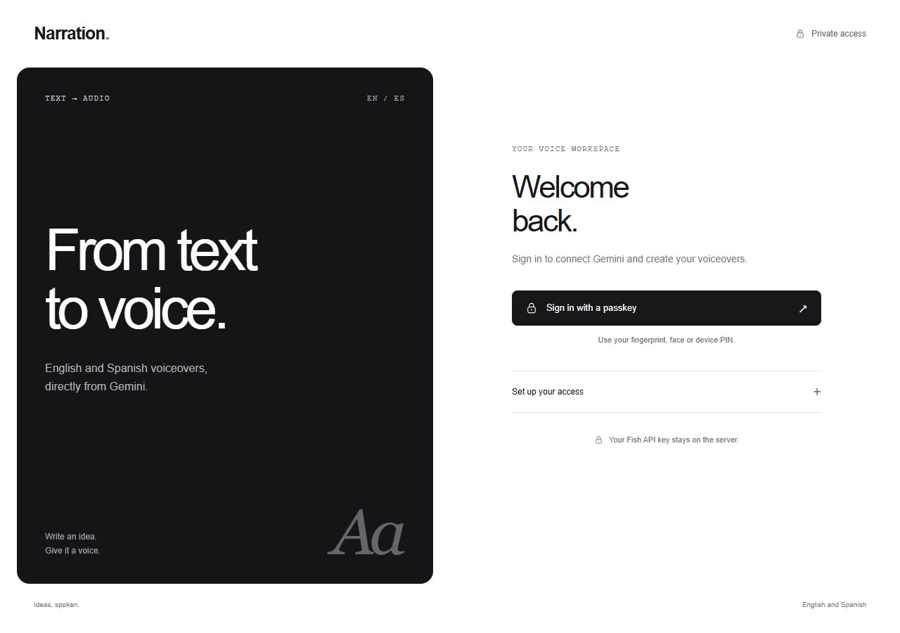
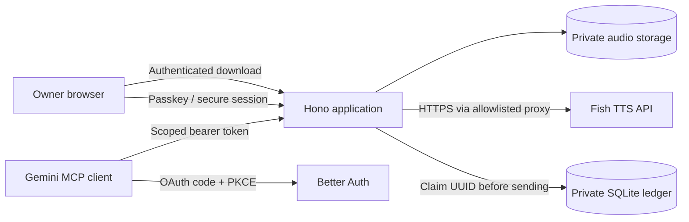

# Fish Free MCP

A single-owner MCP gateway that lets Gemini generate speech with **Fish S2.1 Pro Free** while keeping the provider API key on the server.

This repository is a runnable, sanitized technical-review snapshot by **Kenneth Yepez**. It includes the application, security tests, a constrained container template, and screenshots of the actual local interface. It does not contain a live deployment, credentials, customer material, or production history.



## The problem and the result

A connected voice integration can expose only its paid models, even when the provider offers a separate free API model. Passing an API key into each conversation also gives the chat access to a credential it does not need.

This gateway exposes three narrow MCP tools and keeps synthesis behind an authenticated service. Gemini receives a scoped OAuth connection, not the Fish API key. The application fixes the provider, endpoint, model and playback speed; it cannot silently switch to a paid model.

The originating private deployment was exercised through Gemini: configuration lookup, one Spanish synthesis, retrieval of the same request, and a private MP3 download. The public snapshot does not include that account, recording, hostname or operational evidence. See [verification scope](docs/VERIFICATION.md) for the checks reproducible from this repository and their limits.

## Start the local review

Use Node.js **24 LTS** and npm.

```sh
npm ci --ignore-scripts
npm run build
npm test
npm run preview:local
```

Open **http://localhost:38875**. This is an isolated UI fixture: it binds to loopback, creates temporary local state, does not connect to Fish, and has no real API key or activation credential. The sign-in and setup interface is real; the fixture is not a working voice-generation demo. Stop it with Ctrl+C.

```sh
npm run typecheck
npm run check:publication
npm audit
```

The CI workflow repeats build, tests and publication checks on Node 24 and scans Git history for secrets. It does not receive production secrets or deploy anything.

## Architecture



| Area | Implementation |
| --- | --- |
| HTTP and validation | TypeScript, Hono and strict Zod schemas |
| Human authentication | Maintained Better Auth / WebAuthn passkey libraries |
| Machine authorization | OAuth authorization code, PKCE S256, audience and scope checks |
| Job integrity | SQLite ledger, content digest, request UUID and durable status |
| Provider access | Fixed Fish endpoint and model; restricted outbound proxy |
| Delivery | MCP audio content plus a private, owner-authenticated download URL |
| Deployment template | Non-root containers, read-only roots and internal networking |

### Tool contract

| Tool | Purpose | Side effect |
| --- | --- | --- |
| `get_configuration` | Read the fixed model, free-window deadline and limits | None |
| `generate_speech` | Submit one UUID, text and authorized voice ID | One synthesis at most for that request |
| `get_speech` | Recover an existing status or audio | No new synthesis |

Reusing a UUID with different content is rejected. An interrupted or ambiguous upstream result is retained for investigation and is not automatically submitted again. The default limits are one generation in flight, five requests per minute, 100 per day, and 8,000 UTF-8 bytes per request.

## Decisions worth reviewing

- **Use maintained authentication libraries.** The application adds owner/client/session checks around their OAuth and passkey implementations rather than implementing cryptography.
- **Separate access from delivery.** A download URL contains no bearer token or API key and requires the owner's browser session. Some Gemini clients omit binary audio in model context, so the tool also returns that URL as JSON text.
- **Make retries explicit.** Claiming a request before the upstream POST prevents a network failure from becoming a blind duplicate generation.
- **Fail closed on cost.** The only synthesis model is `s2.1-pro-free`. An expired verification window or provider refusal does not activate a paid fallback.
- **Keep the scope small.** This is a single-owner, single-process service, not a multi-tenant platform or a distributed job system.

The provider currently documents a free window through **November 30, 2026**. That date is time-bound, not a permanent promise. Verify [Fish's official offer](https://fish.audio/blog/s2-1-pro-free-api/) before configuring a later deadline. The application stops new synthesis after its configured deadline; existing audio remains retrievable.

## Screenshots

Actual browser captures of the local fixture, using synthetic configuration and no enrolled credential. The images have not been retouched or taken from a production account.

| Desktop | Mobile |
| --- | --- |
|  |  |

## Review map

- [Architecture and failure paths](docs/ARCHITECTURE.md)
- [Security boundary and remaining limitations](SECURITY.md)
- [Verification and screenshot provenance](docs/VERIFICATION.md)
- [Self-hosting prerequisites](docs/DEPLOYMENT.md)
- [`test/security.test.ts`](test/security.test.ts) — meaningful rejection, replay, quota and recovery tests
- [`src/app.ts`](src/app.ts) — authenticated routes and MCP tools
- [`src/auth.ts`](src/auth.ts) — passkeys and OAuth configuration
- [`src/store.ts`](src/store.ts) and [`src/speech.ts`](src/speech.ts) — durable request lifecycle

## Scope and rights

The snapshot removes environment-specific defaults, owner identity, Windows provisioning scripts, private documentation, logs, databases, recordings and Git history. It preserves the core request, authentication and delivery implementation. Public screenshots are from the isolated local fixture; they do not assert that a public service is available.

Copyright 2026 Kenneth Yepez. No open-source license has been granted. Third-party dependencies retain their own licenses.
